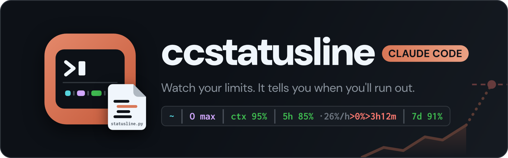
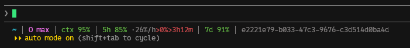

A one-line [status line](https://code.claude.com/docs/en/statusline) for Claude Code with your folder, model, context and rate limits. It also works out where your 5-hour limit ends up at your current pace, so you know if you'll run out before it resets.



## What it shows

| Segment | Meaning |
| --- | --- |
| `~/repos/app` | Folder, with your home as `~`. Past 30 characters, it drops a leading `~/repos/` and turns the middle folders into `…`. |
| `O max` | Model as one letter (O for Opus, S for Sonnet, H for Haiku, F for Fable) and the effort level. A ⚡ in front means fast mode. |
| `ctx 95%` | Context window left. Green at 50% or more, yellow at 20% or more, red below that. |
| `5h 85% ·26%/h>0%>3h12m` | 5-hour limit left, your burn rate and the projection. |
| `7d 91%` | Weekly limit left. |
| `5f0e8a2c-…` | Session ID, for `claude --resume`. |

In the 5h segment, `·26%/h` is your recent burn rate and the rest is where that pace ends up. `>0%>3h12m` in red means you'll hit 0% in 3h12m, before the reset. `>40%>6pm` means about 40% will be left when it resets at 6pm, and it turns yellow under 15%. For the first 3 minutes of a window you'll see `resets 6pm`.

You'll see the 5h and 7d segments when Claude Code includes rate limits in its status data.

## How the burn rate works

On each redraw, the script compares your 5-hour usage with the previous redraw. That rate goes into a running average where older usage loses half its weight every 30 minutes, so one big message doesn't swing it. Raise `HALF_LIFE_S` at the top of the script if you want it steadier.

The script keeps the previous reading in `~/.cache/claude-statusline/state.json`, and all your sessions share it because the limit covers your whole account. Before there's a previous reading, the projection uses your average since the window opened and leaves off the `·%/h`.

## Setup

1. Save the script to `~/.claude`:
   ```sh
   curl -fsSL -o ~/.claude/statusline.py https://raw.githubusercontent.com/jenul-ferdinand/ccstatusline/main/statusline.py
   ```
2. Add this to `~/.claude/settings.json`:
   ```json
   {
     "statusLine": {
       "type": "command",
       "command": "python3 ~/.claude/statusline.py"
     }
   }
   ```

I clone the repo and symlink the script, so `git pull` keeps it up to date:

```sh
git clone https://github.com/jenul-ferdinand/ccstatusline.git ~/repos/ccstatusline
ln -s ~/repos/ccstatusline/statusline.py ~/.claude/statusline.py
```

Python 3, standard library only. Unofficial and not affiliated with Anthropic. MIT licensed.
